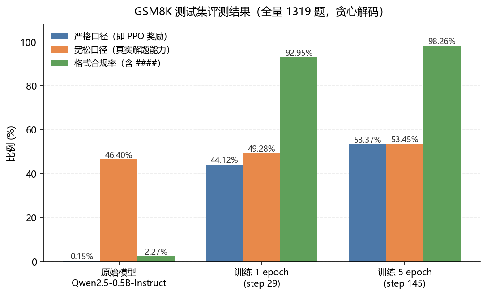
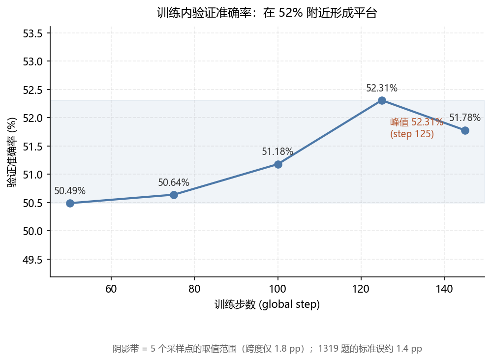
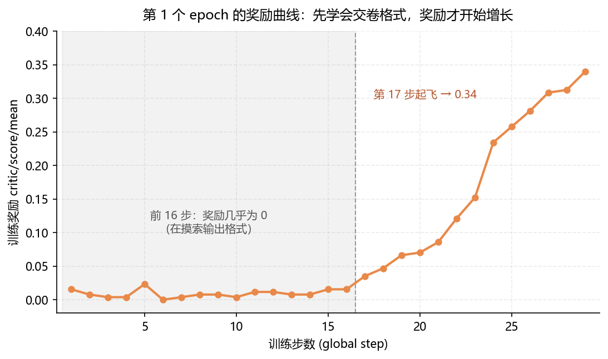

# 让小模型学会做数学题：GSM8K 上的 PPO 实践

> 用 [verl](https://github.com/volcengine/verl) 在**一张 RTX 4090** 上对 `Qwen2.5-0.5B-Instruct` 做 PPO 强化学习。
> GSM8K 准确率 **46.4% → 53.4%**，同时回答了一个更有意思的问题：
> **强化学习到底让模型变聪明了，还是只是教会了它"怎么交卷"？**

*English: PPO / RLVR on GSM8K with verl — single-GPU training plus a dual-metric, paired-significance evaluation harness.*

---

## 结果速览

在 GSM8K 测试集**全量 1319 题**上评测（贪心解码，prompt 与训练完全一致）：

| | 严格口径<sup>①</sup> | 宽松口径<sup>②</sup> | 格式合规率 |
|---|---|---|---|
| 原始 `Qwen2.5-0.5B-Instruct` | 0.15% | **46.40%** | 2.27% |
| 训练 1 epoch | 44.12% | 49.28% | 92.95% |
| 训练 5 epoch | **53.37%** | **53.45%** | **98.26%** |

<sup>①</sup> 严格口径 = 必须按 `#### <答案>` 的格式给出正确答案（这正是 PPO 的奖励函数）
<sup>②</sup> 宽松口径 = 从回答里抽出最终数字比对，不计格式（衡量真实解题能力）

**真实解题能力提升了 7 个百分点**（46.4% → 53.4%），并且经过配对显著性检验：p = 1.5e-06，不是随机波动。

---

## 结果曲线

### 1. 三个模型的评测对比



基座模型"严格口径 0.15% vs 宽松口径 46.4%"这个极端反差，一眼就能看出问题**不在推理能力，而在输出格式**。

### 2. 训练过程：验证准确率在 52% 附近形成平台



5 个验证点的跨度只有 1.8 pp，而 1319 题的标准误就有 1.4 pp——**这条曲线本质上已经是一条平线**。

### 3. 第一阶段的真相：奖励在前 16 步几乎为 0



这一段的形状直接印证了"先学格式、再学能力"：前 16 步模型在摸索怎么把答案写成 `#### <数值>`，奖励几乎为 0；格式一旦学会，奖励立刻起飞。

> 图由 [`assets/make_charts.py`](assets/make_charts.py) 生成，数据取自本次实验的**实测评测结果与训练日志**（非示意图）。
> 完整的交互式曲线（还包含 entropy、KL、critic、显存、耗时等）在 SwanLab：
> [5 epoch 续训](https://swanlab.cn/@gulu4082/verl_gsm8k_ppo/runs/0op4fifk) · [1 epoch](https://swanlab.cn/@gulu4082/verl_gsm8k_ppo/runs/496ed9rb)

---

## 三个值得一读的发现

### 一、原始模型其实早就会做题，只是不会"交卷"

原始模型能解出 **46.4%** 的题（与该模型公开基准一致），但它只有 **2.27%** 的回答带 `####` 格式——而 PPO 的奖励要求这个格式才算分。

于是出现了极端反差：**同一个模型，严格口径只有 0.15%，宽松口径却有 46.4%。**

这说明：**在小模型上做 RLVR，第一个瓶颈往往不是"会不会推理"，而是"能不能按要求的格式把答案交出来"。** 只盯奖励曲线，很容易误判成"模型什么都不会，正在从零学起"。

### 二、前 1 个 epoch 买的是"格式"，之后才是真正的能力

把增益拆开看，两段的性质完全不同：

| 阶段 | 格式合规率 | 严格口径 | **真实能力（宽松口径）** |
|---|---|---|---|
| 原始 → 1 epoch | 2.27% → 92.95% | +43.97 pp | +2.88 pp |
| 1 epoch → 5 epoch | 92.95% → 98.26% | +9.25 pp | **+4.17 pp**（p = 0.0025） |

第一段几乎全是"格式红利"——把模型**本来就有**的能力逼出来；格式饱和之后，第二段才轮到真实能力上升，而且这一段**没有格式可借力**，是实打实学会了更多题。

**实操含义**：评估 RLVR 效果时，如果只看奖励口径，会把"格式红利"误当成"能力提升"。

### 三、到第 5 个 epoch 就该停了——原因不是"数据学完了"

训练内验证曲线（每 25 步一次）：

```
step   50      75      100     125     145
acc    50.49%  50.64%  51.18%  52.31%  51.78%   ← 在 52% 附近形成平台，末期还回落
```

奖励同样在 0.65 附近平台震荡，**但真正的瓶颈是探索枯竭**：

```
actor/entropy:  0.4257 (step 30)  →  0.0664 (step 140)     6 倍坍缩
actor/ppo_kl:   ~2.5e-4    每步策略几乎不再移动
```

也就是说，策略已经变得**近乎确定**——采不出更好的样本了。这时候继续加 epoch 只是浪费算力；**该调的是熵系数、学习率退火或换更大的基座，而不是 epoch 数**。

---

## 它是怎么跑的

单卡、0.5B 模型、vLLM 做 rollout、FSDP 承载 actor 与 critic：

- **算法**：PPO（critic 用 value head），KL 系数 0.001
- **推理**：vLLM 0.30.0，async server 模式（实际生成只需约 4 秒/步）
- **数据**：GSM8K train 7473 条 / test 1319 条，`train_batch_size=256` → **29 步/epoch**
- **成本**：1 epoch ≈ **33 分钟**；5 epoch 共 145 步 ≈ **1 小时 52 分**
- **显存**：峰值约 21.6 GB / 24 GB，单步约 53–58 秒

5 个 epoch 在单张 4090 上一个午休就能跑完。

---

## 快速开始

```bash
# 0) 依赖：Python 3.12 + requirements.txt 里锁定的版本组合
pip install -r requirements.txt
#    verl 不在 PyPI 上，需源码安装（见 requirements.txt 末尾说明）
cd /path/to/verl && pip install -e . && cd -

# 1) 环境准备（补依赖 + 打 3 处兼容补丁，幂等）
bash scripts/setup_env.sh

# 2) 训练（参数 = 总 epoch 数；续训沿用同一 EXPERIMENT 会自动接着跑）
bash scripts/run_ppo.sh 1

# 3) 合并 checkpoint → 评测 → 多 run 对比
bash scripts/finish_and_eval.sh 29
```

> 依赖清单见 [`requirements.txt`](requirements.txt)：版本是实测跑通的组合，
> 其中 **vLLM 会锁定 torch 版本**，所以务必先装它、且不要手工写 `torch==...+cu130`。

---

## 项目结构

```
.
├── requirements.txt             # 依赖清单（实测跑通的版本组合）
├── eval_gsm8k.py                # 评测脚本（双口径，用 vLLM 批量推理）
├── compare_evals.py             # 多 run 对比：置信区间 + 精确 McNemar 配对检验
└── scripts/
    ├── setup_env.sh             # 环境自愈与兼容补丁（幂等）
    ├── run_ppo.sh               # 训练入口（含最终采用的超参）
    └── finish_and_eval.sh       # 合并 checkpoint → 评测 → 对比，一条龙
```

训练产物（checkpoint 约 12 GB、合并后的权重、逐题评测结果）不入库。

---

## 复现时最容易踩的三个坑

1. **必须装 vLLM**：这个 verl 版本的 rollout 只注册了 `vllm / sglang / trtllm` 的 async 实现，`hf` 是死代码、sync 模式已移除。
2. **改离线评测必须关掉 FlashInfer 采样核**（`VLLM_USE_FLASHINFER_SAMPLER=0`），否则引擎起不来；训练路径不受影响。
3. **小心磁盘**：单个 checkpoint 约 12 GB，而实例系统盘只有 30 GB。开启定期存档时"新旧两份并存"会把盘写满并让训练崩在保存阶段——所以我们把存档频率设成只在收尾存一次。

> 想知道该不该停？看**验证曲线**是否连续三次不再创新高。另外 1319 题的验证集标准误约 1.4 pp，曲线上 1~2 pp 的起伏是噪声，**别读成涨跌**——要判断真实提升，请用配对检验（`compare_evals.py`）。

---

## 局限与下一步

- **0.5B 的天花板有限**：GSM8K 上 50% 出头已接近该模型的容量上限；下一步最有性价比的是换 1.5B/3B 基座。
- **最佳 checkpoint 未必是最后一个**：验证与奖励都在 step 125 见顶、145 略回落（幅度在噪声内）。长训时建议能定期存档，以便挑最佳权重。
- **值得调的旋钮**：熵正则（把 entropy 从 0.07 拉回 0.2~0.3）、学习率余弦退火、以及 critic 质量（`vf_explained_var` 长期在 0.04~0.40 之间波动，偏弱）。

---

## 参考

- 训练曲线（SwanLab）：[5 epoch 续训](https://swanlab.cn/@gulu4082/verl_gsm8k_ppo/runs/0op4fifk) · [1 epoch](https://swanlab.cn/@gulu4082/verl_gsm8k_ppo/runs/496ed9rb)
- 框架：[verl](https://github.com/volcengine/verl) · 模型：[Qwen2.5-0.5B-Instruct](https://huggingface.co/Qwen/Qwen2.5-0.5B-Instruct) · 数据：[GSM8K](https://huggingface.co/datasets/openai/gsm8k)
